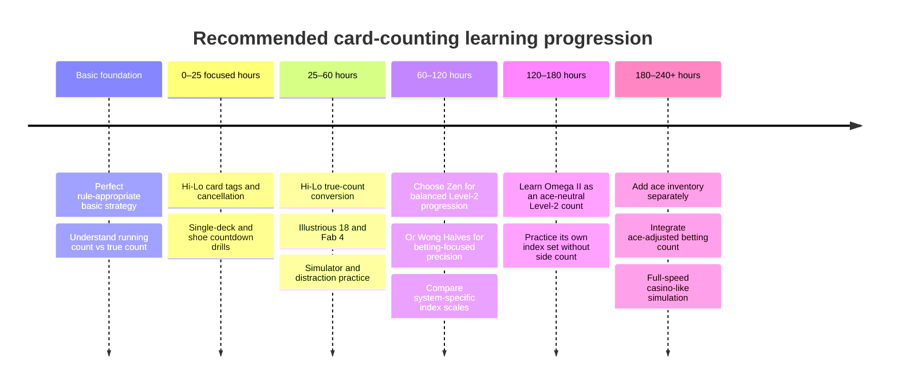

# Free Learning Path for Wong Halves, Zen Count, Omega II, Ace Side Counting, and Hi-Lo

## Executive summary

The five topics are not five equivalent standalone counting systems. **Hi-Lo, Wong Halves, Zen Count, and Omega II are primary counting systems; “Ace Side Counting” is normally an auxiliary count layered on top of another system.** In particular, an ace side count is especially natural with an **ace-neutral** system such as Omega II, where aces receive a primary tag of zero; for ace-reckoned systems such as Hi-Lo, Halves, and Zen, an ace side count is a more specialized playing-efficiency technique and requires adjusted strategy tables. QFIT explicitly distinguishes these two uses. citeturn15search8turn15search10

For practical learning, **Hi-Lo is the best starting point**. It is a balanced Level-1 system with tags of +1 for 2–6, 0 for 7–9, and −1 for ten-valued cards and aces. It has very high betting correlation, 0.97 in the published comparison used here, while requiring substantially less arithmetic than the multi-level alternatives. The same study reports PE/BC/IC values of **0.51/0.97/0.76 for Hi-Lo**, versus **0.56/0.99/0.72 for Wong Halves**, **0.63/0.96/0.85 for Zen**, and **0.67/0.92/0.85 for Omega II**. Those numbers are correlations/efficiency metrics, **not percentages of hands won or guaranteed player edges**. citeturn25view0turn25view1

Among the advanced systems, the choice is primarily about *where complexity is spent*. **Wong Halves** is a Level-3 fractional count optimized strongly for betting; its 0.99 betting correlation is exceptional, but half-point tags substantially increase mental workload. **Zen** is an ace-reckoned Level-2 compromise with strong values across betting, playing, and insurance and needs no routine ace side count. **Omega II** is an ace-neutral Level-2 system with very high playing efficiency; adding an ace side count improves its weaker betting correlation, at the cost of maintaining two pieces of information simultaneously. QFIT classifies Wong Halves as advanced Level 3, Zen as advanced Level 2, and Omega II as advanced Level 2. citeturn15search0turn15search4turn15search7

The strongest **fully free, rights-respecting core curriculum** I found is:

1. [Vidámi, Szilágyi & Iclanzan, *Real Valued Card Counting Strategies for the Game of Blackjack* — direct PDF](https://real.mtak.hu/114350/1/sub_736.pdf), an institutional-repository research paper that gives the tags and PE/BC/IC metrics for all four standalone systems. citeturn16search7turn25view0  
2. [Norman Wattenberger, *Modern Blackjack — Free Version*](https://www.qfit.com/Book/), a free 540-page web book with theory, simulations, strategy material, and some free software/data. citeturn4view1  
3. [QFIT Card Counting Strategy Comparison](https://www.qfit.com/card-counting.htm), for definitions, system classifications, tags, and efficiency comparisons. citeturn15search2turn15search4  
4. [Arnold Snyder, “Count per Deck with the Zen Count”](https://www.lasvegasadvisor.com/gambling-with-an-edge/count-per-deck-with-the-zen-count/), particularly valuable because Snyder is the author associated with Zen and the page publishes his complete Zen true-count index material from *Blackbelt in Blackjack*. citeturn9search1  
5. [QFIT Blackjack Side Counts](https://www.qfit.com/blackjack-side-counts.htm) and [Arnold Snyder, “Are Side Counts Worth the Trouble?”](https://www.lasvegasadvisor.com/gambling-with-an-edge/are-side-counts-worth-the-trouble/) for the ace-side-count mechanics and, just as importantly, when *not* to use one. citeturn15search8turn3search19  
6. [PrintName/BlackjackCardCounter](https://github.com/PrintName/BlackjackCardCounter), an MIT-licensed implementation of Wong Halves, Omega II, and Hi-Lo, plus [mhluska/blackjack-simulator](https://github.com/mhluska/blackjack-simulator), an MIT-licensed modern Hi-Lo trainer/simulator with Illustrious 18 and Fab 4 logic. citeturn11view0turn11view2

A significant finding from the source audit is that the canonical books behind several systems remain copyrighted. I did **not** treat unofficial scans of Stanford Wong's *Professional Blackjack*, Bryce Carlson's *Blackjack for Blood*, Arnold Snyder's *Blackbelt in Blackjack*, Edward Thorp's *Beat the Dealer*, or Peter Griffin's *The Theory of Blackjack* as legitimate free sources. Where a canonical work is not legally open, the guide below substitutes author-published pages, institutional PDFs, and source code rather than linking to questionable mirrors. QFIT identifies *Professional Blackjack* as the source for High-Low/Halves, *Blackbelt in Blackjack* for Zen, and *Blackjack for Blood* for Omega II. citeturn15search0turn15search1turn15search6

## Comparison and technical baseline

The most useful way to compare counts is not by vague claims such as “more accurate,” but by separating three jobs. **Playing Efficiency (PE)** estimates how well a count supports departures from basic strategy; **Betting Correlation (BC)** measures how closely the count tracks changes in player betting advantage caused by the remaining composition; and **Insurance Correlation (IC)** measures suitability for the insurance decision. The academic source notes that PE matters particularly in one- and two-deck games, while a BC approaching 1.00 indicates increasingly strong correlation with betting advantage. citeturn25view0turn25view1turn25view2

| System | Tags in order **A, 2, 3, 4, 5, 6, 7, 8, 9, T/J/Q/K** | Type / complexity | PE | BC | IC | Index/deviation model | Practical assessment |
|---|---|---:|---:|---:|---:|---|---|
| **Hi-Lo** | −1, +1, +1, +1, +1, +1, 0, 0, 0, −1 | Balanced, Level 1; lowest difficulty here | .51 | **.97** | .76 | Commonly learned first with **Illustrious 18 + Fab 4**; examples include insurance +3, 16v10 = 0, 15v10 = +4, 12v3 = +2, 12v2 = +3, 10v10 = +4 | Best general starting point; excellent complexity/benefit ratio |
| **Wong Halves** | −1, +0.5, +1, +1, +1.5, +1, +0.5, 0, −0.5, −1 | Balanced, fractional Level 3; high difficulty | .56 | **.99** | .72 | Use Halves-specific indices; do not blindly copy Hi-Lo numerical indices | Best raw betting correlation of these four, but the fractional RC is demanding |
| **Zen Count** | −1, +1, +1, +2, +2, +2, +1, 0, 0, −2 | Balanced, ace-reckoned Level 2; medium-high difficulty | **.63** | .96 | **.85** | Snyder publishes complete Zen TC indices; examples include 16v10 = 0, 15v10 = +6, 12v4 = +1, 12v3 = +3, 12v2 = +6 under his stated convention | Strong all-round advanced count without routine ace side counting |
| **Omega II** | 0, +1, +1, +2, +2, +2, +1, 0, −1, −2 | Balanced, ace-neutral Level 2; high difficulty | **.67** | .92 | **.85** | Large/full index set; optional ace side count materially improves betting information | Excellent playing efficiency; most logical of these for an ace-side-count overlay |
| **Ace side count** | Not a standalone tag vector | Auxiliary/multi-parameter technique; expert | N/A | N/A | N/A | Alters the primary count for specified betting/playing decisions; no universal independent index set | Valuable mainly when the chosen primary system has a specific ace-information deficiency |

The first four tag vectors and PE/BC/IC figures come directly from the 2020 open research paper; QFIT independently classifies Hi-Lo as Level 1, Omega II and Zen as Level 2, and Wong Halves as Level 3. citeturn25view0turn15search2turn15search4

For Hi-Lo, an actively maintained open-source implementation gives a particularly useful concrete reduced index set. Its source implements the Illustrious 18 and Fab 4 with such thresholds as insurance at TC ≥ +3, 16v10 standing at ≥0, 15v10 standing at ≥+4, 10v10 doubling at ≥+4, 12v3 standing at ≥+2, and 12v2 at ≥+3. The program source is at `src/hi-lo-deviation-checker.ts`. fileciteturn7file0L1-L6

Those index numbers are **not interchangeable between systems**. A true count of +4 in Hi-Lo and +4 in Zen does not represent the same vector scale because the underlying card tags differ. Zen's author-published tables, for example, put 15v10 at +6 under the convention on that page, rather than Hi-Lo's familiar +4. Similarly, Halves and Omega II should use indices generated/published for those systems and for the relevant deck/rule/true-count convention. citeturn9search1turn17search4

“More accurate” also does not automatically mean “more profitable in human hands.” The academic paper explicitly notes that larger tag ratios improve theoretical correlation but increase computational complexity, and concludes that a simpler strategy played accurately can outperform a theoretically stronger strategy that causes human errors. citeturn25view0

## System-by-system source guide

**Hi-Lo — beginner/intermediate difficulty**

Hi-Lo keeps a running count by adding +1 for each 2–6, doing nothing for 7–9, and subtracting 1 for each 10/J/Q/K/A. Because it is balanced, a complete deck sums to zero. In multi-deck play the running count is normally converted to a true count using estimated decks remaining. Historically, the Complete Point-Count/Hi-Lo method was introduced by Harvey Dubner in 1963 and subsequently refined by Julian Braun and presented in Thorp's *Beat the Dealer*. The open academic paper reports BC .97, PE .51 and IC .76. citeturn16search7turn25view0

**Priority free sources**

1. **[Real Valued Card Counting Strategies — direct PDF](https://real.mtak.hu/114350/1/sub_736.pdf)** — best concise research source for the exact Hi-Lo tags, historical attribution, and quantitative comparison with the advanced systems. The paper is hosted by the Repository of the Library of the Hungarian Academy of Sciences. citeturn16search2turn25view0

2. **[Modern Blackjack — Free Version](https://www.qfit.com/Book/)** — Norman Wattenberger's free, 540-page web book. It moves well beyond card tags into actual blackjack analysis, true counts, index use, simulations, risk, and betting. It also links to simulation output including Hi-Lo data and to free software material. citeturn4view1

3. **[mhluska/blackjack-simulator](https://github.com/mhluska/blackjack-simulator)** — MIT-licensed and unusually useful because it covers both training and simulation: Hi-Lo counting, basic strategy, Illustrious 18, Fab 4, configurable betting, and simulation of large numbers of hands. citeturn11view2  
   Key paths include `src/hi-lo-deviation-checker.ts` for I18/Fab 4, `src/card.ts` for the card/count representation, `src/shoe.ts` for running/true-count handling, and `LICENSE`. The repository tree contains an explicit `LICENSE` file, and its Hi-Lo code is directly searchable in those source files. fileciteturn5file0L1-L2 fileciteturn6file0L2-L18  
   Direct file: https://github.com/mhluska/blackjack-simulator/blob/master/src/hi-lo-deviation-checker.ts  
   ZIP: https://github.com/mhluska/blackjack-simulator/archive/refs/heads/master.zip

**Secondary resources**

[Blackjack in Color](https://www.blackjackincolor.com/) is an excellent visual/quantitative supplement: it contains roughly 145 charts and discusses true-count frequency, advantage by count, index effects, strategy comparison, penetration, betting, variance, and risk. It is free to read but copyrighted rather than open-licensed. citeturn2search3

[BJ21's glossary](https://bj21.com/glossary) is useful for standardized terminology. It defines Hi-Lo as a balanced Level-1 count, describes the Illustrious 18 as the 18 highest-value Hi-Lo deviations, defines the Fab Four, and gives 16v10 = 0 as an example index. citeturn17search4

For practice rather than theory, the MIT-licensed simulator above is preferable to many commercial trainers because the index logic is inspectable. Its source presently encodes the familiar I18/Fab4 threshold table instead of hiding it in a proprietary application. fileciteturn7file0L1-L6

**Wong Halves — advanced difficulty**

Wong Halves is a balanced, fractional Level-3 system. It assigns +0.5 to 2 and 7, +1 to 3/4/6, +1.5 to 5, 0 to 8, −0.5 to 9, and −1 to tens and aces. The fractional tags produce an outstanding BC of .99 in the cited comparison, but a lower PE of .56 and IC of .72. QFIT describes it as an advanced Level-3 strategy using fractions and optimized for betting. citeturn25view0turn15search4

A common mental adaptation is to **double every tag** so the running count uses integers: 2/7 = +1; 3/4/6 = +2; 5 = +3; 8 = 0; 9 = −1; tens/aces = −2. That arithmetic removes half-points but doubles the count's scale, so any index/true-count convention must be scaled consistently rather than mixing the doubled running count with undoubled indices. The academic paper confirms the original fractional vector; the scaling observation follows mathematically from multiplying the entire count vector by two. citeturn25view0

**Priority free sources**

1. **[Real Valued Card Counting Strategies — PDF](https://real.mtak.hu/114350/1/sub_736.pdf)** — the cleanest rights-respecting free source I found for exact Wong Halves tags and direct quantitative comparison. It reports BC .99, the highest among the four systems examined here. citeturn25view0

2. **[QFIT Card Counting Strategy Summary](https://www.qfit.com/card-counting.htm)** and **[QFIT Blackjack Strategies Summary](https://www.qfit.com/blackjack-strategies.htm)** — identifies Halves as a balanced Level-3 count, describes its fractional nature and betting emphasis, and attributes it to Stanford Wong's *Professional Blackjack*. citeturn15search2turn15search4

3. **[PrintName/BlackjackCardCounter](https://github.com/PrintName/BlackjackCardCounter)** — an MIT-licensed Python/PyQt implementation supporting Wong Halves, Omega II, and Hi-Lo. It calculates true count, tracks dealt cards/decks, plots the true-count trend and can display remaining-card probabilities. citeturn11view0  
   Key path: `BlackjackCardCounter.py`; the repository also contains `BlackjackCardCounter.ui`, `README.md`, and an explicit `LICENSE`. fileciteturn4file0L1-L10  
   Direct file: https://github.com/PrintName/BlackjackCardCounter/blob/master/BlackjackCardCounter.py  
   Raw source: https://raw.githubusercontent.com/PrintName/BlackjackCardCounter/master/BlackjackCardCounter.py  
   ZIP: https://github.com/PrintName/BlackjackCardCounter/archive/refs/heads/master.zip  
   License: https://github.com/PrintName/BlackjackCardCounter/blob/master/LICENSE

4. **[william-ma/blackjack-card-counting](https://github.com/william-ma/blackjack-card-counting)** — source-visible Java/Spring trainer supporting Hi-Lo, Hi-Opt I/II, KO, Omega II, Red 7, Halves and Zen Count. citeturn23search2  
   Exact Halves path: `src/main/java/blackjack/cardcounting/strategies/Halves.java`; the same directory holds `HiLo.java`, `OmegaII.java` and `ZenCount.java`. fileciteturn3file0L1-L2  
   Direct file: https://github.com/william-ma/blackjack-card-counting/blob/master/src/main/java/blackjack/cardcounting/strategies/Halves.java  
   ZIP: https://github.com/william-ma/blackjack-card-counting/archive/refs/heads/master.zip  
   I found no `LICENSE` entry in the retrieved repository tree, so I regard this as **publicly source-visible but not confirmed open-source** rather than assigning it an OSS license. fileciteturn3file0L1-L2

**Secondary resources**

**[bjstrat.net](https://bjstrat.net/)** is useful after the tags are mastered because it can generate strategy-deviation indices via combinatorial analysis for counting systems rather than forcing the learner to transpose Hi-Lo indices. Its site specifically notes Wong Halves in connection with its calculation service. citeturn2search1

[QFIT's strategy documentation](https://www.qfit.com/CVBlackjackHelp/aboutplayingstrategies.htm) distinguishes ordinary Halves from “Halves with Aces,” calling the latter very complex. That is a good warning against adding a side count before ordinary Halves is completely automatic. citeturn15search6

I found **no verified, unrestricted, rights-cleared full copy of Stanford Wong's canonical *Professional Blackjack*** that I would recommend as a free download. Rather than send you to unauthorized scans, use the free sources above; QFIT and Wizard of Odds both identify Wong's book as the canonical comprehensive reference. citeturn15search1turn17search0

**Zen Count — intermediate/advanced difficulty**

Zen is a balanced, ace-reckoned Level-2 count. Its tags are +1 for 2/3/7, +2 for 4/5/6, 0 for 8/9, −2 for tens, and −1 for aces. Its published PE/BC/IC combination of .63/.96/.85 is notably balanced: substantially better playing and insurance correlation than Hi-Lo while retaining excellent betting correlation. citeturn25view0

**Priority free sources**

1. **[Arnold Snyder, “Count per Deck with the Zen Count”](https://www.lasvegasadvisor.com/gambling-with-an-edge/count-per-deck-with-the-zen-count/)** — the most important free Zen source I found. It is by Snyder himself and reproduces complete Zen true-count indices from his *Blackbelt in Blackjack* material while explaining the conventional conversion of running count to true count. Representative entries include 16v10 = 0, 15v10 = +6, 12v4 = +1, 12v3 = +3 and 12v2 = +6. The page identifies the index material as copyrighted by Arnold Snyder, so it is legitimate free reading but not open-license content. citeturn9search1

2. **[Real Valued Card Counting Strategies — PDF](https://real.mtak.hu/114350/1/sub_736.pdf)** — verifies the tag vector and reports PE .63, BC .96, IC .85. citeturn25view0

3. **[william-ma/blackjack-card-counting](https://github.com/william-ma/blackjack-card-counting)** — public implementation useful for reading/testing the tag logic. Its `ZenCount.java` gives exactly the tag vector above. citeturn23search2 fileciteturn8file0L1-L6  
   Path: `src/main/java/blackjack/cardcounting/strategies/ZenCount.java`  
   Direct file: https://github.com/william-ma/blackjack-card-counting/blob/master/src/main/java/blackjack/cardcounting/strategies/ZenCount.java  
   Again, no explicit license was visible in the retrieved tree, so use it as a learning/reference implementation rather than assuming redistribution rights. fileciteturn3file0L1-L2

**Secondary resources**

[QFIT's strategy overview](https://www.qfit.com/blackjack-strategies.htm) characterizes Zen as an advanced Level-2 balanced system optimized for betting, while [QFIT's strategy-set documentation](https://www.qfit.com/CVBlackjackHelp/aboutplayingstrategies.htm) distinguishes basic and complete implementations and confirms Zen is one of the supported established systems. citeturn15search4turn15search6

For a useful historical/community discussion of how the count scales, [“How to learn Zen Count?” at BlackjackInfo](https://www.blackjackinfo.com/community/threads/how-to-learn-zen-count.8314/) discusses scaling Zen values while maintaining consistent index scaling. Treat forum material as explanation and cross-check it against Snyder's tables rather than as the definitive source. citeturn24search24

A second useful comparison thread is [“Omega 2 vs zen”](https://www.blackjackinfo.com/community/threads/omega-2-vs-zen.22060/), where experienced forum participants focus on the human-cost issue: Omega II plus an ace side count can be stronger in some circumstances, but Zen is substantially easier to execute. The thread is anecdotal rather than a primary mathematical source, so the PE/BC/IC table above should remain the quantitative reference. citeturn24search3turn25view0

An important practical conclusion from Snyder's side-count article is that **Zen is not an obvious candidate for ace side counting**. Snyder specifically argues against routinely side-counting aces with Zen because its main count already has strong betting correlation. citeturn3search19

**Omega II — advanced difficulty**

Omega II, created by Bryce Carlson, is a balanced ace-neutral Level-2 count: aces and eights are zero; 2, 3 and 7 are +1; 4, 5 and 6 are +2; 9 is −1; and ten-valued cards are −2. It has PE .67 and IC .85—both strong—but BC .92 is lower than Hi-Lo, Zen and Halves because the primary count deliberately ignores aces. citeturn15search0turn25view0

That apparent weakness is intentional and explains the classic Omega-II/ace-side-count combination: the primary count can remain strong for playing decisions, while separate ace information is incorporated when estimating betting strength. QFIT specifically says an ace side count improves Omega II's betting efficiency. citeturn15search0turn15search3

**Priority free sources**

1. **[QFIT Omega II](https://www.qfit.com/cardcounting/Omega-II/)** — best concise freely accessible technical profile. It identifies Omega II as advanced, balanced Level 2, gives all card tags, BC .92, PE .67, IC .85, notes its large index set, and explicitly recommends the ace-side-count concept for improving betting efficiency. citeturn15search0

2. **[Real Valued Card Counting Strategies — PDF](https://real.mtak.hu/114350/1/sub_736.pdf)** — independent academic confirmation of tags and metrics; it describes Omega II as more complex and attributes it to Bryce Carlson. citeturn25view0

3. **[PrintName/BlackjackCardCounter](https://github.com/PrintName/BlackjackCardCounter)** — MIT-licensed Omega II/Hi-Lo/Halves practice implementation. Its Python source contains the Omega II logic along with true-count functionality. citeturn11view0  
   Path: `BlackjackCardCounter.py`  
   Direct source: https://github.com/PrintName/BlackjackCardCounter/blob/master/BlackjackCardCounter.py  
   Raw: https://raw.githubusercontent.com/PrintName/BlackjackCardCounter/master/BlackjackCardCounter.py  
   ZIP: https://github.com/PrintName/BlackjackCardCounter/archive/refs/heads/master.zip  
   License: https://github.com/PrintName/BlackjackCardCounter/blob/master/LICENSE

4. **[seblau/BlackJack-Simulator](https://github.com/seblau/BlackJack-Simulator)** — a public Python Omega II simulator. Its README gives the Omega II tags and the project accepts a strategy CSV; `BlackJack.py` is the main program and `strategy/BasicStrategy.csv` is a relevant input file. citeturn12view1turn13view3  
   Main path: `BlackJack.py`  
   Strategy path: `strategy/BasicStrategy.csv`  
   I did not find a clearly displayed OSS license in the reviewed repository material, so I recommend it as **source-available educational code**, not as a confidently licensed open-source package. citeturn13view3

5. **[william-ma/blackjack-card-counting](https://github.com/william-ma/blackjack-card-counting)** — includes a separate Omega-II strategy class alongside Zen, Halves and Hi-Lo. citeturn23search2  
   Path: `src/main/java/blackjack/cardcounting/strategies/OmegaII.java` fileciteturn3file0L1-L2  
   Direct: https://github.com/william-ma/blackjack-card-counting/blob/master/src/main/java/blackjack/cardcounting/strategies/OmegaII.java

**Secondary resources**

The best companion is [QFIT Blackjack Side Counts](https://www.qfit.com/blackjack-side-counts.htm), because merely memorizing Omega's primary tags leaves out why ace-neutral systems exist. QFIT's betting-side-count procedure is to estimate excess/deficient remaining aces, weight them by the magnitude of the primary count's ten-card tag, temporarily adjust the running count, and recompute the betting true count—while retaining the ordinary primary count for strategy use. citeturn15search8

The [Omega II versus Zen forum discussion](https://www.blackjackinfo.com/community/threads/omega-2-vs-zen.22060/) is useful for the practical trade-off between theoretical power and execution burden, but should remain secondary to QFIT and the academic metrics. citeturn24search3

The canonical Omega II presentation is Bryce Carlson's *Blackjack for Blood*. QFIT identifies the book and its publication history, but I found no unrestricted rights-cleared free full text that I would recommend; unofficial PDF mirrors therefore are deliberately absent from this report. citeturn15search0

**Ace Side Counting — expert auxiliary technique**

There is no single universal “Ace Side Count system” equivalent to Hi-Lo or Zen. It is an extra parameter. The critical distinction is:

For **ace-neutral primary counts** such as Omega II, keeping a separate ace count generally supplies missing **betting** information. For **ace-reckoned primary counts** such as Hi-Lo, Halves and Zen, QFIT describes a different use: separate ace information can refine **playing** decisions, but that requires strategy tables designed for the side count. citeturn15search8

**Priority free sources**

1. **[QFIT — Blackjack Side Counts](https://www.qfit.com/blackjack-side-counts.htm)** — the clearest free technical treatment I found. It separately explains ace-side counts for betting, ace-side counts for playing, ten side counts, betting side counts, and multi-parameter side counts. It explicitly lists Omega II among ace-neutral systems and Hi-Lo/Halves/Zen among ace-reckoned systems. citeturn15search8

2. **[Arnold Snyder — “Are Side Counts Worth the Trouble?”](https://www.lasvegasadvisor.com/gambling-with-an-edge/are-side-counts-worth-the-trouble/)** — an expert primary-author essay useful for deciding whether the extra arithmetic is justified. Snyder illustrates combining a separate ace/deuce side count with another primary count for betting, while warning that adding an ace side count to an already high-BC count can impose more work than benefit. citeturn3search19

3. **[QFIT — How to Create a Blackjack Strategy](https://www.qfit.com/how-to-count-cards.htm)** — useful conceptual explanation of why side counts exist: aces have unusual dual roles, and ace-neutral systems commonly side-count them to improve betting accuracy. citeturn15search10

**Secondary/forum resources**

[BJ21: “How to properly execute an Ace Side Count with Hi-Opt 2??”](https://bj21.com/boards/free/sub_boards/free/topics/how-to-properly-execute-an-ace-side-count-with-hi-opt-2) is a useful implementation discussion for an ace-neutral Level-2 system, even though the primary count there is Hi-Opt II rather than Omega II. citeturn3search7

[BJ21: “Ken Uston on Ace side count”](https://bj21.com/boards/free/sub_boards/free/topics/ken-uston-on-ace-side-count) and [BJ21: “Ace side count strategies”](https://bj21.com/boards/free/sub_boards/free/topics/ace-side-count-strategies) provide historical/practical discussion. These are community sources and should be used to clarify technique only after the QFIT/Snyder material establishes the method. citeturn3search11turn3search35

The practical implication is important: **do not learn an ace side count as your first counting skill.** It adds a second information stream, remaining-card normalization, and possibly altered index tables. QFIT notes that adding side counts can improve efficiency but makes the strategy harder to use; its efficiency discussion specifically observes this trade-off for high-PE ace-neutral systems such as Omega II. citeturn15search3turn15search8

## Practice progression and learning-time estimates

The hour estimates below are **planning estimates, not published guarantees**. Individual speed varies enormously. They are deliberately based on mastery milestones rather than “read this for X hours and you are ready.” The ordering is supported by the published complexity distinction between Level-1 and higher-level systems and by the research finding that excessive arithmetic can erase a theoretical system advantage through execution errors. citeturn15search10turn25view0

| System / stage | Approximate focused practice | A reasonable mastery test before advancing |
|---|---:|---|
| Basic strategy foundation | 5–15 h if new to blackjack | Rule-specific basic strategy is effectively automatic |
| **Hi-Lo tags + running count** | 5–10 h | Full decks counted accurately with no corrections |
| Hi-Lo deck estimation + true count | 10–20 h | Running count and deck estimate maintained simultaneously |
| Hi-Lo I18/Fab4 + betting logic | 10–25 h | Deviations recalled instantly without losing count |
| **Hi-Lo complete functional foundation** | **25–60 h** beyond basic strategy | Accurate under conversation/noise, not just quiet drills |
| **Zen from Hi-Lo** | **30–60 additional h** | Level-2 tags and Zen-specific indices no longer confused with Hi-Lo |
| **Wong Halves from Hi-Lo** | **35–70 additional h** | Fractional/doubled tags, TC conversion and Halves-specific indices remain consistent |
| **Omega II without side count** | **40–80 additional h** | Primary Level-2 count and selected Omega-specific deviations automatic |
| **Ace side count overlay** | **25–60 additional h** | Primary count, ace inventory and appropriate adjusted count can all be maintained without mistakes |
| Omega II + side count at casino-like proficiency | Often **100–200+ total advanced-practice hours** | No meaningful degradation during full-speed multi-hand practice |

For **Hi-Lo**, begin with tag recognition only. Run through shuffled decks while ignoring strategy decisions. Then add cancellation: pairs such as 5/K or 3/A cancel immediately, reducing working-memory load. Once the running count is automatic, add deck estimation and true-count conversion. Only then add deviations. The reason for this separation is practical: Hi-Lo's high BC already does most of the betting-information job without requiring a complicated tag vector. citeturn25view0turn17search4

For the first deviation package, use **Illustrious 18 + Fab 4** rather than attempting hundreds of indices immediately. BJ21 describes the Illustrious 18 as the most advantageous Hi-Lo deviations and notes that they capture a large share of the strategy-deviation gain, while the open-source trainer supplies an inspectable implementation of both sets. citeturn17search4 fileciteturn7file0L1-L6

For **Zen**, transition only after Hi-Lo true-count arithmetic is effortless. The main retraining problem is not just +2 tags; it is preventing Hi-Lo numbers from contaminating Zen-specific indices. Snyder's table should therefore become the authoritative drill sheet rather than mentally “converting” familiar Hi-Lo indices on the fly. citeturn9search1

For **Wong Halves**, first drill the raw fractional vector, then decide whether you personally perform better with halves or with all tags doubled to integers. Once that choice is made, keep it fixed. Do not use one scaling for the running count and another for remembered indices. The system's theoretical attraction is its .99 BC; the advantage disappears quickly if arithmetic load increases the error rate. citeturn25view0

For **Omega II**, learn the primary system *without* an ace side count first. Once its ordinary running and true counts plus core playing indices are automatic, start a separate ace-inventory exercise. Only in the final stage should you combine the two and temporarily construct a betting-adjusted count. QFIT's description is explicit that an ace-neutral system's ace adjustment is ordinarily for betting while the base count remains the strategy count. citeturn15search8

A useful performance progression for every system is: quiet single-deck countdown → multi-deck running count → true-count estimation → one-hand decision drills → deviations → variable numbers of exposed cards → background conversation/audio → full simulated table sessions. The aim is to discover errors before real money is involved. The academic comparison's warning that complex systems may underperform simpler perfectly executed ones is especially relevant here. citeturn25view0

## Licensing, legality, and responsible-use notes

**Copyright is distinct from free access.** The QFIT *Modern Blackjack* web edition is free to read but explicitly marked copyrighted/all rights reserved; the same is true of *Blackjack in Color*. Snyder's freely accessible Zen-index page identifies the underlying index material as his copyrighted work. You may learn from and link to these pages, but “available at no cost” does not mean that you can republish their tables wholesale, redistribute a scraped copy, or incorporate them into another project under an open-source license. citeturn4view1turn2search3turn9search1

The two safest reusable code sources in this report are **PrintName/BlackjackCardCounter** and **mhluska/blackjack-simulator**, because their repositories contain explicit licenses and the GitHub material identifies them as MIT-licensed. The former is especially useful for Halves/Omega II/Hi-Lo, while the latter is strongest for Hi-Lo simulation and I18/Fab4 practice. citeturn11view0turn11view2 fileciteturn4file0L1-L10 fileciteturn5file0L1-L2

By contrast, a public GitHub repository without a license file should **not automatically be treated as open-source for redistribution**. For this reason I have labeled `william-ma/blackjack-card-counting` and the reviewed Omega II simulator as source-visible educational references unless/until an explicit license is established. Their code remains useful for inspecting algorithms, but this report does not infer reuse permissions merely from public visibility. fileciteturn3file0L1-L2

On legality, distinguish **mental calculation from electronic assistance**. Nevada's current NRS 465.075, revised on the legislature's site through April 15, 2026, expressly prohibits using or possessing with intent to use computerized, electronic, electrical or mechanical devices, software or hardware designed to gain an advantage by, among other things, keeping track of cards, analyzing probabilities, or analyzing playing/betting strategy in a licensed gaming establishment. That means the GitHub tools in this report are appropriate for **off-table study/simulation**, not for covert use while gambling in a Nevada casino. citeturn19search0

Casino exclusion rights are jurisdiction-specific. A famous counterexample to a simplistic “every casino can always ban counters” rule is **Uston v. Resorts International Hotel**, in which the New Jersey Supreme Court held under New Jersey's regulatory framework that Resorts could not exclude Uston for card counting on the facts and law then before it. That New Jersey result should not be generalized to Nevada, Armenia, another U.S. state, or another country; local gaming law, trespass rules, casino regulations and house policies need to be checked separately. citeturn20search1turn20search0

None of the efficiency figures in this report means guaranteed profit. BC, PE and IC are measures of how well a counting vector tracks particular mathematical quantities; actual results additionally depend on game rules, penetration, bet sizing, number of decks, index accuracy, execution errors and variance. QFIT's free material devotes substantial treatment to true-count distributions, betting, variance and risk rather than treating counting as a deterministic win mechanism. citeturn25view0turn2search3turn4view1

The safest way to use the open-source programs is therefore as **offline trainers and simulators**: test tag accuracy, generate or verify deviations, study variance, and compare systems before wagering anything. Never assume a phone, smartwatch, laptop, concealed computer, or other real-time aid is lawful at a gaming table merely because the underlying counting algorithm is lawful to study. Nevada is a concrete example where the device distinction is codified. citeturn19search0

## Recommended curriculum and timeline

For someone who ultimately wants to understand **all five topics**, learning them in the order Hi-Lo → Zen/Halves → Omega II → ace side count is more efficient than attempting each from scratch. Hi-Lo establishes the universal skills—running count, balanced-count cancellation, deck estimation, true-count conversion, betting correlation and index departures—without imposing Level-2/3 arithmetic. Zen then demonstrates multi-level counting without requiring an ace-neutral architecture; Halves adds fractional precision; Omega II introduces the ace-neutral design; and the ace side count finally makes sense as an answer to a specific information deficit rather than as an arbitrary extra task. QFIT's classifications and the published performance comparison support this increasing-complexity sequence. citeturn15search4turn15search8turn25view0

The timeline is an **illustrative self-study sequence rather than an empirical certification standard**. The better gate is observable performance: advance only when the current stage can be performed with negligible errors while simultaneously making normal blackjack decisions. This follows the central practical lesson of the quantitative literature: increasing count sophistication can raise mathematical correlations, but increasing cognitive load can make a nominally stronger system inferior when human error enters the process. citeturn25view0

For a **beginner who wants one system to actually master**, the strongest recommendation from this source review is **Hi-Lo**. It gives BC .97 with Level-1 arithmetic, has the largest ecosystem of freely inspectable simulation/deviation tools among the systems reviewed, and provides an easy bridge to later systems. citeturn25view0turn11view2turn17search4

For someone already flawless with Hi-Lo who wants more playing sensitivity without a side count, **Zen is the most attractive next study**: PE rises from .51 to .63 and IC from .76 to .85 while BC remains .96, and Snyder has made a complete set of Zen indices freely readable. citeturn25view0turn9search1

For a learner whose main intellectual goal is maximizing betting correlation and who can genuinely perform fractional or doubled Level-3 arithmetic without mistakes, **Wong Halves** is the natural specialist branch because its published BC is .99. The price is complexity, while its PE and IC are not superior to Zen/Omega II. citeturn25view0turn15search4

For advanced study of multi-parameter counting, **Omega II plus an ace side count** is the most instructive end point. Omega II deliberately leaves aces out of the primary count, yields PE .67, and then allows the missing ace information to be reintroduced for betting. This makes the logic of side counting transparent in a way that simply adding an ace count to Hi-Lo or Zen does not. citeturn15search0turn15search8turn25view0

The resulting compact resource stack is therefore: [academic comparison PDF](https://real.mtak.hu/114350/1/sub_736.pdf) → [Modern Blackjack](https://www.qfit.com/Book/) → [mhluska Hi-Lo simulator](https://github.com/mhluska/blackjack-simulator) → [Snyder's Zen indices](https://www.lasvegasadvisor.com/gambling-with-an-edge/count-per-deck-with-the-zen-count/) → [PrintName Halves/Omega/Hi-Lo counter](https://github.com/PrintName/BlackjackCardCounter) → [QFIT Omega II](https://www.qfit.com/cardcounting/Omega-II/) → [QFIT side-count guide](https://www.qfit.com/blackjack-side-counts.htm). Together these provide a legal, non-video, freely accessible route from introductory counting through advanced multi-level and ace-side-count work without relying on unauthorized copies of the canonical copyrighted books. citeturn16search7turn4view1turn11view2turn9search1turn11view0turn15search0turn15search8